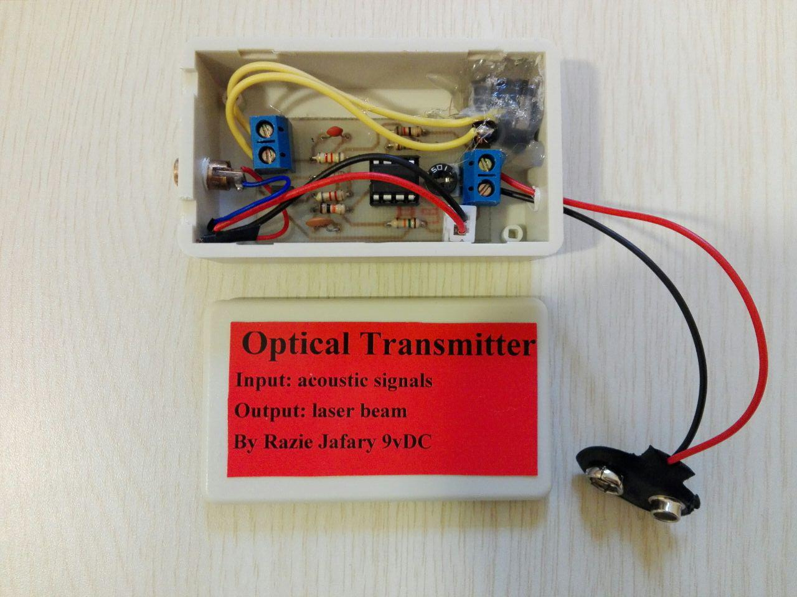
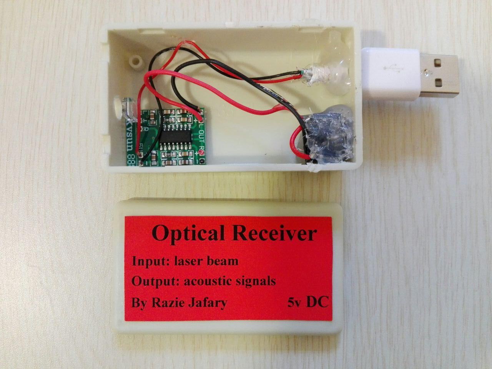
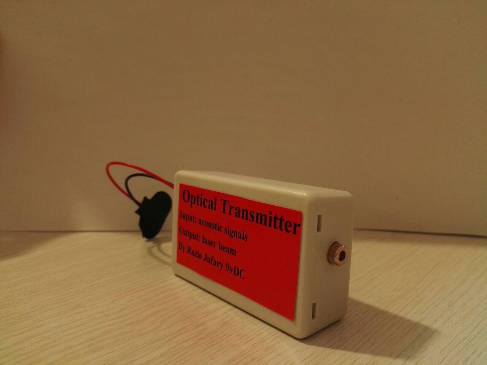
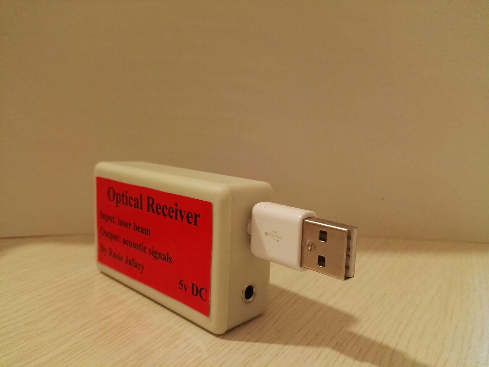
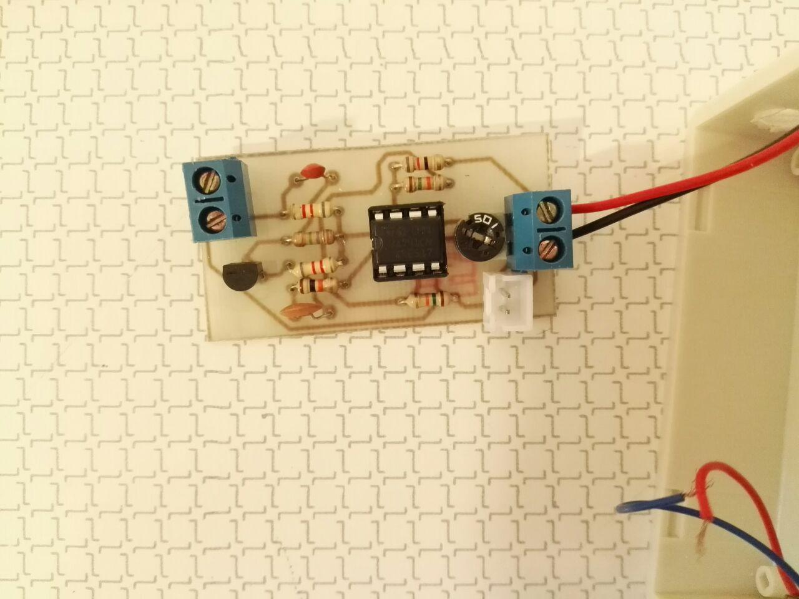
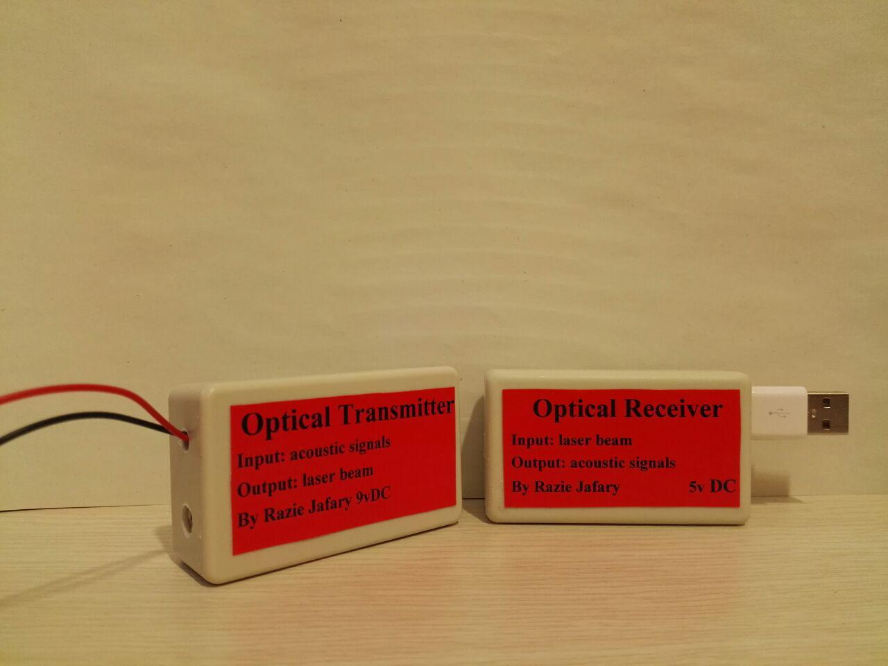

# Free-Space Optical Audio Communication System

**Bachelor's Thesis | Engineering Science — Telecommunications**  
Salman Farsi University of Kazerun | 2017  
**Author:** Razia Jafari

## Project Overview

This project presents the design and hardware implementation of a short-range **free-space optical (FSO) communication system** for transmitting analog audio signals using a laser beam.

The system converts an electrical audio signal into variations in laser intensity. At the receiver, a photodiode detects the modulated light and converts it back into an electrical signal, which is amplified for audio playback.

The project combines analog electronics, optical communications, signal conditioning, and PCB design.

## System Architecture

```text
Audio Input
    |
    v
Signal Conditioning & Amplification
    |
    v
Laser Driver & Direct Modulation
    |
    v
Laser Transmitter
    |
    v
Free-Space Optical Channel
    |
    v
BPW46 PIN Photodiode
    |
    v
Audio Amplification
    |
    v
Audio Output
```

The transmitter and receiver require an unobstructed optical path and proper alignment.

## Transmitter Design

The transmitter processes the input audio signal through analog conditioning and amplification stages before applying it to the laser drive circuit.

The audio signal modulates the laser output through variations in its electrical drive conditions, enabling analog information transmission over the optical channel.

Key implementation aspects include:

- Transistor-based input signal conditioning and biasing.
- Capacitive coupling to separate AC audio signals from DC bias.
- Adjustable amplification and laser drive circuitry.
- PCB layout designed using **Altium Designer**.
- Assembly and integration of the transmitter into a physical enclosure.

## Receiver Design

The receiver uses a **BPW46 PIN photodiode** to detect the incoming modulated laser beam.

The photodiode converts incident optical variations into an electrical signal, which is amplified to recover the transmitted audio.

During development, different transistor-based and operational-amplifier configurations were investigated. These approaches produced noticeable noise in the recovered signal.

Following these experiments, a **PAM8403 Class-D audio amplifier module** was selected for the receiver implementation.

This stage of the project provided practical experience with:

- Photodiode-based optical detection.
- Analog amplification.
- Noise and signal-quality limitations.
- Circuit biasing and coupling.
- Hardware troubleshooting and component selection.

## Hardware Implementation

The project includes a physical transmitter and receiver prototype.

The transmitter was implemented using a custom-designed PCB, while the receiver integrates the optical detector and audio amplification circuitry.

The original thesis documents:

- Transmitter circuit schematic.
- Altium PCB layout.
- Assembled transmitter PCB.
- Completed transmitter enclosure.
- Receiver amplifier module.
- Completed receiver prototype.
### Prototype Gallery

| Prototype 1 | Prototype 2 |
|---|---|
| |  <p align="center"><b>Figure 1.</b> Optical Transmitter — Internal Hardware Assembly</p> |  | |  |
|  |  |
|  |  |

## Results and Limitations

The prototype demonstrated short-range analog audio transmission through a free-space optical channel.

The thesis reports satisfactory output at distances of approximately **1 meter**.

The principal engineering challenges involved:

- Optical alignment between transmitter and receiver.
- Noise introduced by receiver amplification stages.
- Proper biasing of active components.
- Signal coupling and amplification.
- Maintaining usable recovered audio quality.

The thesis does not provide a quantified bit-error rate, signal-to-noise ratio, or extended-distance performance study. The results should therefore be understood as a hardware proof of concept rather than a fully characterized communication link.

## Technologies and Skills

**Optical Communications:** Free-Space Optics, Laser Modulation, PIN Photodiodes

**Electronics:** Analog Circuit Design, Transistors, Operational Amplifiers, Signal Conditioning

**Hardware:** PCB Design, Altium Designer, Circuit Assembly, Prototype Testing

**Engineering Methods:** Experimental Troubleshooting, Noise Analysis, Component Selection

## Documentation

The original bachelor's thesis, written in Persian, provides the theoretical background, circuit explanations, hardware photographs, and component information.

**Project type:** Undergraduate hardware design and implementation  
**Year:** 2017

---

*This repository documents an undergraduate engineering project and its original hardware implementation.*
